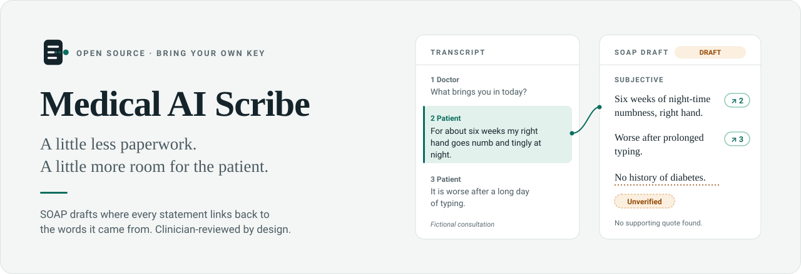
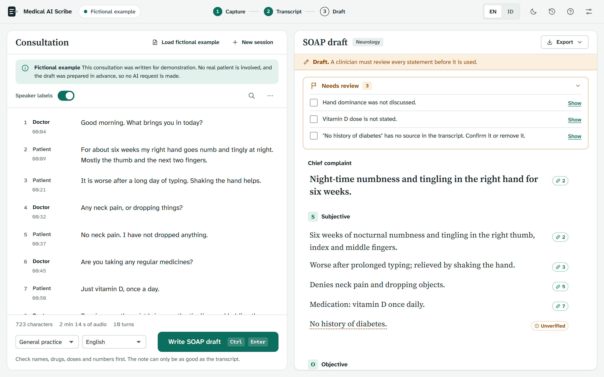
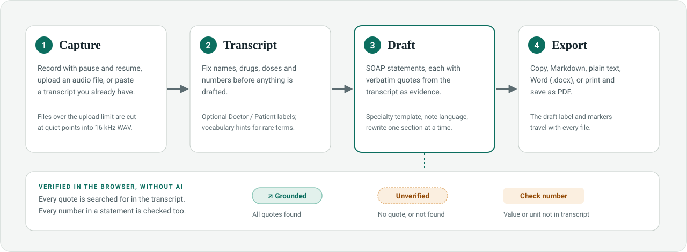
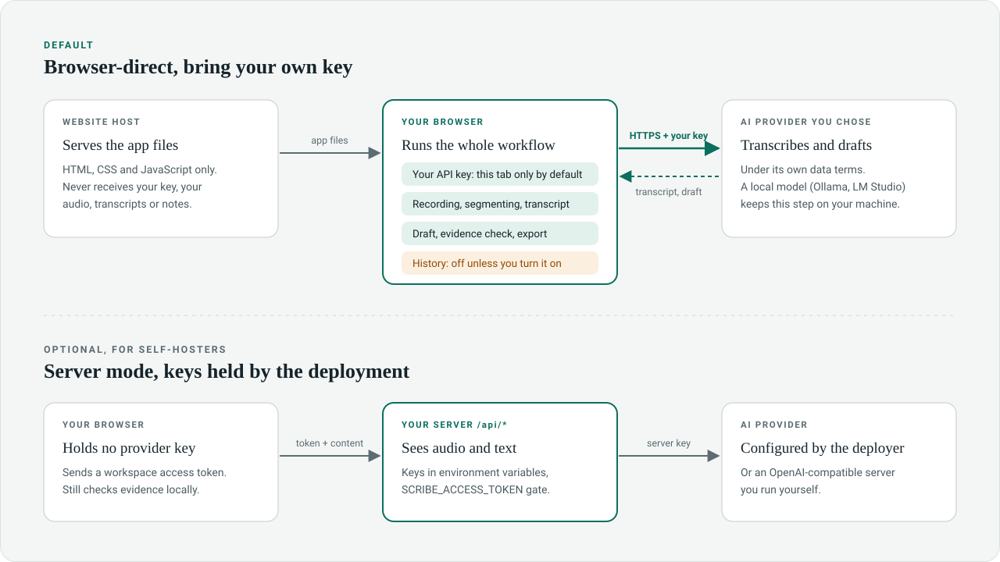

<p align="center"></p>

<p align="center">
  <a href="https://github.com/arthamegayasa/medical-ai-scribe/actions/workflows/checks.yml"></a>
  <a href="LICENSE"></a>
  
  
</p>

<p align="center">
  <a href="https://medicalaiscribe.vercel.app"><strong>Open the app</strong></a> ·
  <a href="#try-it-in-30-seconds">Try it</a> ·
  <a href="#how-evidence-linking-works">Evidence linking</a> ·
  <a href="#supported-providers">Providers</a> ·
  <a href="#privacy-architecture">Privacy</a> ·
  <a href="#quick-start">Quick start</a> ·
  <a href="docs/self-hosting.md">Self-hosting</a>
</p>

# Medical AI Scribe

**A little less paperwork. A little more room for the patient.**

Medical AI Scribe turns a clinical consultation, recorded, uploaded or pasted, into a **SOAP note draft** and shows which words of the conversation support each line. You connect your own AI provider; the browser talks to it directly. You review the draft, correct it, and decide what goes into the record.

It is free, open source under the [MIT License](LICENSE), and written in plain HTML, CSS and JavaScript with no runtime dependencies and no build step.

> [!IMPORTANT]
> **Medical AI Scribe is not a medical device and does not diagnose or treat.** It produces documentation drafts that a qualified clinician must review, statement by statement, before any use. Language models can omit, misattribute or invent details; the evidence checks described below help you find those problems but cannot guarantee their absence. Obtaining consent to record, accepting your AI provider's data-processing terms and meeting local regulations remain the responsibility of the user and the deployer. See [Clinical safety](#clinical-safety).

<picture>
  <source media="(prefers-color-scheme: dark)" srcset="docs/workspace-dark.png">
  <source media="(prefers-color-scheme: light)" srcset="docs/workspace-light.png">
  
</picture>

<sub>Screenshot of the current workspace showing the built-in fictional example. No real patient is involved and no AI request was made.</sub>

## Try it in 30 seconds

1. Open **[medicalaiscribe.vercel.app](https://medicalaiscribe.vercel.app)** and choose **Try the fictional example**.
2. Point at a line in the draft, or select its link chip, to see the transcript turns that support it.
3. Look at the statement marked **Unverified** and the **Needs review** list: that is what the app does when the source is missing or unclear.

The example is a written, fictional consultation with a prepared draft. It needs no key, no account and makes no AI request.

## What it does

| | |
| --- | --- |
| **Capture** | Record in the browser with pause and resume, upload an audio file (MP3, M4A, WAV, WebM, OGG, FLAC), or paste a transcript. Lines starting with `Doctor:` or `Patient:` become labelled turns. |
| **Two models, your choice** | One model transcribes, another writes the note. They can come from different providers, or from a model on your own machine. |
| **Long recordings** | Files larger than the provider's upload limit are decoded in the browser and cut at quiet points into 16 kHz mono WAV segments, transcribed in order and joined. |
| **Speaker labels (optional)** | Use provider diarization where available, or ask the note model to label turns Doctor, Patient or Other. Relabelling is rejected if any word changes. |
| **Evidence-linked SOAP draft** | Chief complaint, Subjective, Objective, Assessment, Plan. Every statement carries verbatim transcript quotes, checked without AI. |
| **Review flags** | Unclear wording, contradictions, uncertain numbers or drug names, and possible mistranscriptions, collected in one list. |
| **Specialty templates** | General practice, neurology, emergency, internal medicine, paediatrics and psychiatry in the workspace; the engine also has a follow-up visit template. Templates change emphasis only; they never license adding content. |
| **Languages** | Interface in English and Bahasa Indonesia. Notes in English or Bahasa Indonesia, independent of the spoken language; the engine also supports Spanish, French, German and Portuguese notes. The fictional example is available in English and Bahasa Indonesia. |
| **Section rewrite** | Regenerate one SOAP section while the rest of your edited draft stays as it is. |
| **Export** | Copy, Markdown, plain text, Word (.docx), or print and save as PDF. The draft label, unverified markers, numbers to check and provenance travel with every format. |
| **History, only if you want it** | Session history is off by default. Turned on, it stays in this browser only and can auto-delete. |

## How evidence linking works

This is the part of the design that matters most. A fluent draft is easy to trust and hard to check; the app is built so that checking is the default.

<p align="center"></p>

1. **The model must cite.** The note model is asked for strict JSON in which every statement has `text` and `evidence`: one or more short quotes copied character for character from the transcript. The transcript is passed as untrusted data, so instructions inside it are not obeyed. Empty sections say "Not documented in this encounter." instead of being filled in.
2. **The output is validated.** Exact keys, non-empty sections, bounded lengths. Output that fails is rejected with an error; it is never shown as a note.
3. **Every quote is checked, deterministically.** In the browser, without another AI call, each quote is searched for in the transcript. Matching ignores case, accents, punctuation and spacing; quotes of three or more words may differ by about 15% of their words to tolerate small transcription differences.
4. **Every statement gets a status.**
   - **Grounded**: it has at least one quote and every quote was found. The link highlights the exact span in the transcript.
   - **Unverified**: no quote, or a quote that is not in the transcript. Confirm it from your own knowledge of the encounter or delete it.
   - **Check number**: any number in the statement, with its unit, that does not appear in the transcript. Decimal commas, thousands separators, unit synonyms and common English and Indonesian number words are understood.
5. **Drift is tracked.** Edit the transcript after drafting and the note is marked as possibly out of date, including in exports, until you rewrite it.

Grounded does not mean correct. A quote can be found and still be misread, taken out of context or attributed to the wrong speaker. The checks narrow what you have to look at; they do not replace reading the draft against the encounter.

## Supported providers

Generated from the catalog in [`web/core/providers.js`](web/core/providers.js). Model IDs in the app come live from your key where the provider allows listing; otherwise you type the model ID.

| Provider | Note model | Transcription | Speaker diarization | Model list | Upload limit per request | From the browser |
| --- | :---: | :---: | :---: | :---: | ---: | --- |
| OpenAI | yes | yes | yes, with `gpt-4o-transcribe-diarize` | yes | 25 MB | Direct |
| Anthropic Claude | yes | – | – | yes | – | Direct |
| Google Gemini | yes | yes, without timestamps | – | yes | 14 MB | Direct |
| OpenRouter | yes | – | – | yes | – | Direct |
| Groq | yes | yes (Whisper) | – | yes | 25 MB | Direct |
| Mistral | yes | yes (Voxtral) | yes | yes | 25 MB | Direct |
| Deepgram | – | yes | yes | – | 100 MB | Direct, transcription only (see below) |
| ElevenLabs | – | yes (Scribe) | yes | – | 100 MB | Direct |
| Local model (Ollama, LM Studio) | yes | if the server offers `/audio/transcriptions` | – | yes | 25 MB | After you enable CORS on the local server |
| Custom OpenAI-compatible endpoint | yes | yes | – | yes | 25 MB | Only if the endpoint allows CORS |

"Direct" means a CORS preflight from `https://medicalaiscribe.vercel.app` was verified on 2026-11-17 for every endpoint and header set the engine sends. Provider behaviour can change; [CONTRIBUTING.md](CONTRIBUTING.md#adding-a-provider-preset) describes how to re-check.

**Caveats you will meet:**

- **Deepgram** allows cross-origin calls only on `POST /v1/listen`. The app therefore cannot list Deepgram models or test the key in advance; the key is checked on the first transcription.
- **Ollama and LM Studio** reject requests from other origins until you allow them. For Ollama, set `OLLAMA_ORIGINS` to the app's origin; for LM Studio, enable CORS in its server settings. Some browsers also block or prompt before a public HTTPS page may call a server on `localhost`; running the app locally avoids that. A local note model does not make transcription local. See the [provider setup guide](docs/providers.md).
- **Custom endpoints** must answer CORS preflights for the app's origin with `Authorization` and `Content-Type` allowed. If they do not, the browser reports a network error that it cannot distinguish from an outage; use server mode instead.

Provider names belong to their owners and are listed only to describe compatibility. Each provider sets its own models, prices and data terms.

## Privacy architecture

<p align="center"></p>

**Browser-direct (default).** The site that serves the app delivers static files and nothing else. Your key, audio, transcript and draft go from your browser to the provider you chose, over HTTPS. The app server never receives them.

- **Keys** are kept for the current tab by default. You can choose to remember a key on this device; it is then stored in this browser's storage, where anyone using the same browser profile could use it. Connection settings without the key (provider, name, endpoint) are kept on the device as preferences.
- **History** is off by default. When turned on, transcripts and drafts are stored in this browser only, can be deleted automatically after 1, 7 or 30 days, and can all be erased in one step.
- **The provider still sees what you send** and processes it under its own terms. Check them, and use de-identified material unless your agreements and local rules allow otherwise.

**Server mode (optional, for self-hosters).** Provider keys live in the deployment's environment variables, and the browser holds only a workspace access token. Audio and text then pass through that server on the way to the provider. The server does not store them, and its handlers return fixed error messages that never include keys, provider responses or transcript text. Your hosting platform's own request logs are outside the app's control.

**Content Security Policy.** Scripts, styles, fonts and images load only from the app's own origin; inline scripts and styles are blocked; the app cannot be framed. Because you may connect to any provider, `connect-src` allows any HTTPS origin plus `localhost`. The reasoning is in [ADR 0006](docs/adr/0006-connect-src-https-csp.md).

This project makes **no claim of compliance** with HIPAA, GDPR or any other healthcare or data-protection regime, and has not been clinically validated. Whether you may use it with patient data depends on your provider agreements, your institution and your jurisdiction.

## Quick start

Requires Node.js 20 or newer (CI runs 20, 22 and 24) and npm. There are no packages to download; `npm ci` only checks the empty lockfile.

```bash
git clone https://github.com/arthamegayasa/medical-ai-scribe.git
cd medical-ai-scribe
npm ci
npm run dev
```

Open <http://127.0.0.1:3000>, load the fictional example, then add a connection in **Settings → Connections** with your own key. The dev server binds to `127.0.0.1` and reads an optional `.env` file; set `PORT` to use another port.

### Self-host

**Vercel.** Import the repository into your own Vercel project. `vercel.json` already sets the build command (`npm run build`), the output directory (`public/`), the security headers and the serverless functions under `api/`. With no environment variables the deployment runs in browser-direct mode.

**Any static host.** Browser-direct mode needs only files. Run `npm run build` and publish `public/`, and configure your host to send the same headers as `vercel.json`, in particular the Content-Security-Policy.

**Any Node host.** `npm start` serves `web/` and the `/api/*` routes with the production headers, bound to `127.0.0.1`. Put a reverse proxy in front of it that terminates TLS and preserves the `Host` header.

Details, including a checklist before sharing a deployment, are in the [self-hosting guide](docs/self-hosting.md).

### Server mode

Copy `.env.example` to `.env` (PowerShell: `Copy-Item .env.example .env`) or set the variables in your host's dashboard, add at least one provider key and an access token, and restart.

```dotenv
ANTHROPIC_API_KEY=...
OPENAI_API_KEY=...            # also used for transcription by default
SCRIBE_ACCESS_TOKEN=<long random secret>
```

Users enter the access token in the app; it is not a provider key. On Vercel, or whenever `NODE_ENV=production`, the AI endpoints refuse all requests until `SCRIBE_ACCESS_TOKEN` is set.

## Configuration reference

All variables are optional and apply to server mode only. Browser-direct mode needs none of them. Local processes read `.env`; variables already set in the environment take precedence.

| Variable | Purpose |
| --- | --- |
| `OPENAI_API_KEY`, `ANTHROPIC_API_KEY`, `GEMINI_API_KEY`, `OPENROUTER_API_KEY`, `GROQ_API_KEY`, `MISTRAL_API_KEY` | Enable that provider for note writing and speaker labelling. |
| `OPENAI_MODEL`, `ANTHROPIC_MODEL`, `GEMINI_MODEL`, `OPENROUTER_MODEL`, `GROQ_MODEL`, `MISTRAL_MODEL` | Default model ID for that provider. If unset, the preset's balanced mid-tier model is used. Users can choose another. |
| `COMPATIBLE_BASE_URL`, `COMPATIBLE_API_KEY`, `COMPATIBLE_MODEL` | An OpenAI Chat Completions-compatible server. Include `/v1`. HTTPS is required except on `localhost`, `127.0.0.1` or `[::1]`. |
| `TRANSCRIPTION_PROVIDER` | `openai` (default), `groq`, `mistral`, `gemini`, `deepgram` or `elevenlabs`. |
| `TRANSCRIPTION_API_KEY` | Transcription key. If empty, that provider's key variable above is used. |
| `DEEPGRAM_API_KEY`, `ELEVENLABS_API_KEY` | Keys for those transcription providers. |
| `TRANSCRIPTION_BASE_URL` | A custom OpenAI-compatible `/audio/transcriptions` server instead of a named provider. It receives only `TRANSCRIPTION_API_KEY`, never another provider's key. |
| `TRANSCRIPTION_MODEL` | Default transcription model ID. |
| `SCRIBE_ACCESS_TOKEN` | Workspace access token for `/api/*`. Required on Vercel and when `NODE_ENV=production`. |
| `PORT` | Port for `npm run dev` and `npm start` (default 3000). |

Server-mode limits: 3 MB of audio per request (the browser segments larger files), transcripts up to 250,000 characters, and no streaming.

## Architecture

```text
web/                 The site, served as-is (no bundler)
  index.html         Landing page
  app/               Workspace shell (UI-CONTRACT.md documents its hooks)
  assets/            CSS tokens and components, UI scripts, EN/ID strings, fonts, icons
  core/              The engine: plain ES modules shared by browser and server
    providers.js     Provider catalog, connection and endpoint validation
    chat.js          Text generation with structured-output fallback and streaming
    transcribe.js    Transcription per provider, segment upload with retries
    audio/           Decoding, 16 kHz mono resampling, WAV encoding, silence-aware cuts
    soap/            Prompt, strict schema, note generation, evidence verification
    speakers.js      Speaker labelling with a word-for-word check
    export/          Markdown, text, DOCX and print output
    server-client.js Client for server mode
lib/                 Server mode: configuration, request guard, handlers, build and check scripts
api/                 Vercel function entry points (config, generate-soap, label-speakers, process-audio)
dev-server.js        Local and Node-host server
tests/               node:test suites with mocked providers
docs/                Guides, ADRs and images
```

The same engine runs in both modes: in the browser for browser-direct mode, and imported by `lib/handlers.js` for server mode. Its API is documented in [`web/core/README.md`](web/core/README.md). Consequential decisions are recorded in [`docs/adr/`](docs/adr/), and terms are defined in [GLOSSARY.md](GLOSSARY.md).

## Testing

```bash
npm run check   # syntax-checks every JavaScript file
npm test        # node --test: engine, server and build suites
npm run build   # copies web/ into public/, skipping docs, tests and dotfiles
```

The test suites use mocked provider responses. They cover request formats per provider, structured-output fallback, streaming, strict schema validation, evidence and number matching, speaker-label verification, audio segmentation, exports, server-mode authentication, origin checks, size limits and safe error responses. Passing tests show that the integration follows each provider's documented protocol; they are not live API calls and they are not clinical validation.

`npm run test:e2e` runs browser end-to-end tests with no npm dependencies. It starts the app and a local mock provider, then drives an installed Chrome or Edge over the DevTools protocol (set `CHROME_PATH` if the browser is not in a standard location). The scenarios cover the fictional example, connecting a provider, recording, long-audio upload in segments, streamed drafting, evidence highlighting, every export format, history, key storage, error recovery, static hosting, server mode and a phone-sized viewport.

## Roadmap

Current work:

- Wiring the workspace shell to the engine (the shell and engine exist; the connecting layer is in progress).
- Browser end-to-end tests against a mock provider.

Next, based on gaps in the current code:

- Offer every engine note language in the workspace, not only English and Bahasa Indonesia.
- Offer the engine's follow-up visit template in the workspace.

Suggestions are welcome as [feature requests](https://github.com/arthamegayasa/medical-ai-scribe/issues/new/choose).

## Contributing

Contributions are welcome, especially from clinicians who can report where drafts go wrong. Read [CONTRIBUTING.md](CONTRIBUTING.md) for setup, the zero-dependency and CSP rules, and how to add a provider, template or language. Please follow the [Code of Conduct](CODE_OF_CONDUCT.md), and report security issues privately as described in [SECURITY.md](SECURITY.md).

## Clinical safety

- The output is a **draft**. It is labelled as one in the app and in every export, and the label cannot be removed in the workspace.
- A qualified clinician must read every statement against the encounter before it is used. Pay particular attention to medications, doses, numbers, laterality and anything marked unverified or flagged for review.
- The model is instructed to record only what was said, including the clinician's own stated assessment and plan, and not to add diagnoses, findings or advice. Instructions are not guarantees.
- The project publishes no accuracy figures. Quality depends on the model, the audio, the transcript and the encounter.
- Ask the patient's permission before recording, follow your institution's policies, and use real patient data only where your provider agreements and local law allow it.

## About

Created by [Artha Megayasa](https://www.arthamegayasa.com), a neurologist. The project began as a presentation demo and is now developed independently. It has no institutional affiliation or endorsement.

## License

[MIT](LICENSE) © 2026 Artha Megayasa. Bundled fonts (Source Serif 4, Atkinson Hyperlegible Next) are under the SIL Open Font License; their licence texts are in [`web/assets/fonts/`](web/assets/fonts/).
